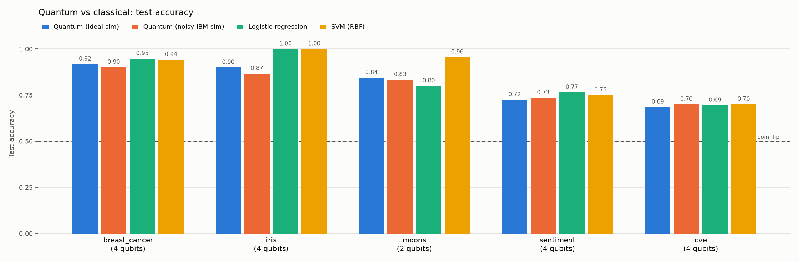
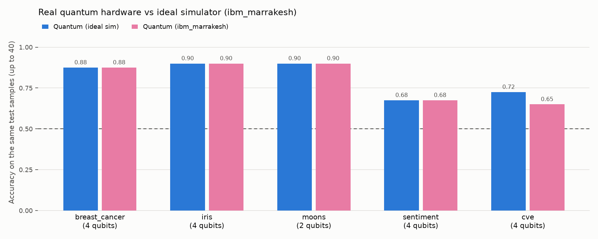

# Quantum text classifier (IBM Quantum ready)

A small, honest quantum machine-learning project built with Qiskit. A 4-qubit
quantum neural network (QNN) classifies text. It runs on a local simulator, on a
simulated noisy IBM device, or on real IBM Quantum hardware:

- **Sentiment**: is a movie-review style opinion positive or negative?
- **CVE severity**: from a vulnerability description, is it HIGH/CRITICAL or LOW/MEDIUM?

Every quantum result is reported next to classical baselines on the same data,
because at this size quantum offers no advantage. The point is to learn how
quantum ML works and what hardware noise does to it, not to beat classical models.

The repo also scans its own dependencies for known CVEs (`security/`).

> Despite the repo's name, this is not an AGI. It is an experiment and a learning tool.

## How it works

```
text ──► sentence embedding (all-MiniLM-L6-v2, 384 numbers)
     ──► PLS: squeeze to 4 numbers that best predict the label, scaled to [0, π]
     ──► 4-qubit circuit: [RY(x) encoding → trainable RealAmplitudes layer] × 2
     ──► measure qubit 0 ──► P(class 1)
```

The classical encoder does most of the heavy lifting. The QNN makes the final
call on 4 numbers. The circuit's weights are trained on exact simulated
probabilities with L-BFGS-B on cross-entropy loss.

## Results

**Trained text classifiers** (`python train.py`, full test sets):

| Task | Test texts | Majority class | Quantum (4 qubits) | Logistic reg. (same 4 features) | Logistic reg. (full embedding, all data) |
|---|---|---|---|---|---|
| Sentiment | 1,066 | 0.500 | 0.758 | 0.769 | 0.774 |
| CVE severity | 2,424 | 0.578 | 0.699 | 0.692 | 0.715 |

The QNN trains on 600 texts. The PLS reducer and the full-embedding baseline use the whole
training split (8,530 sentences / 9,692 CVEs). CVEs are split by publication date,
so the model is tested on CVEs published after the ones it learned from.

**Benchmark** (`python -m benchmark.run_benchmark`): the same trained weights on an
ideal simulator and on a simulated noisy 5-qubit IBM device (`FakeManilaV2`),
against classical models on the same reduced features:



**Real quantum hardware** (`--hardware`, IBM `ibm_marrakesh`, 156-qubit Heron
processor, 1,024 shots). The same trained weights on the same 40 test samples
(30 for iris), compared with the ideal simulator:



| Dataset | Ideal sim | ibm_marrakesh |
|---|---|---|
| breast_cancer | 0.875 | 0.875 |
| iris | 0.900 | 0.900 |
| moons | 0.900 | 0.900 |
| sentiment | 0.675 | 0.675 |
| cve | 0.725 | 0.650 |

The whole run used about a minute of quantum time over 5 jobs.

Takeaways:
- The QNN comes within about 0–10 points of classical models, and never clearly beats them.
- On real hardware, 4 of 5 datasets gave exactly the same answers as the noise-free simulator. The transpiled circuit is shallow: depth 37, 6 two-qubit gates.
- CVE flipped 3 of 40 answers in that run. A follow-up study reran the same 40 samples 3 more times on `ibm_marrakesh` ([results/hardware_repeats_cve.md](results/hardware_repeats_cve.md), `python -m benchmark.hardware_repeats`). It found 5 flips in total against 3.45 expected from 1,024-shot sampling alone (p ≈ 0.27). No sample flipped in every run, and every flipped sample had an ideal probability within 0.025 of 0.5. **The drop is shot noise, not a hardware bias.** The device's mean shift in P(class 1) was −0.006.
- The local noise model (`FakeManilaV2`, an older 5-qubit device) is more pessimistic than today's hardware. Its mean shift was −0.030, five times larger, and it flipped 2 samples in every run ([results/hardware_repeats_cve_fake.md](results/hardware_repeats_cve_fake.md)).
- An earlier design (`ZZFeatureMap`, parity readout, training on sampled shots) barely beat a coin flip. Circuit design matters more than qubit count here.

Full tables: [results/benchmark.md](results/benchmark.md), [results/sentiment.json](results/sentiment.json), [results/cve.json](results/cve.json).

## Setup

Requires Python 3.11+ (developed on 3.12).

```bash
python3.12 -m venv .venv
source .venv/bin/activate
pip install -r requirements.txt
```

The first run downloads the datasets into `data/` (gitignored) and the embedding
model (~91 MB) into the Hugging Face cache:
- Rotten Tomatoes sentences (~0.8 MB, Hugging Face)
- NVD CVEs published Jan–Apr 2024 (~53 MB over the NVD API, stored as ~2 MB)

Trained models are committed in `models/`, so the chat works without retraining.

## Usage

All commands run from the repo root.

```bash
# Chat with a classifier
./run_local.sh                       # sentiment
./run_local.sh --task cve            # CVE severity; paste a vulnerability description

# Retrain (about 4 to 5 minutes each)
python train.py --task sentiment
python train.py --task cve
python train.py --task cve --qubits 6 --train-samples 1000   # bigger and slower

# Quantum vs classical benchmark with a simulated noisy IBM device
python -m benchmark.run_benchmark                    # all datasets, about 10 minutes
python -m benchmark.run_benchmark --datasets iris moons

# Run on IBM Quantum (see ibmq/README_IBMQ.md for credentials)
python -m ibmq.run_on_ibmq --fake                    # simulated IBM noise, no account needed
python -m ibmq.run_on_ibmq --task cve "Heap overflow in the TLS parser allows remote code execution"
python -m benchmark.run_benchmark --hardware          # adds a real-hardware comparison
python -m benchmark.hardware_repeats --dataset cve --repeats 3   # shot noise vs device bias

# Scan dependencies for known CVEs (pip-audit)
./security/audit_deps.sh
```

## Repo layout

```
run.py, run_local.sh      chat app (perceive → reason → act → reflect)
train.py                  train a text classifier → models/<task>.joblib
core/
  qnn_core.py             circuit, QNN, training
  features.py             standardise → PCA/PLS → angles in [0, π]
  text_encoder.py         sentence embeddings
  text_tasks.py           sentiment + CVE tasks, datasets, cached embeddings
  cve_data.py             NVD API download and parsing
  text_classifier.py      load a trained model and score text
  agent.py, memory.py     chat agent and session memory
benchmark/                quantum vs classical benchmark, hardware repeat study → results/
ibmq/                     IBM Quantum Runtime scripts and credentials guide
security/                 dependency CVE scan (pip-audit)
.github/workflows/        weekly and on-change dependency audit in CI
models/                   trained models (committed)
results/                  benchmark chart and tables, training metrics, audit report
data/                     downloaded datasets and embeddings (gitignored)
```

## Limitations

- 4 qubits means 4 numbers per text. The classical encoder and PLS decide most of what the model can know.
- Training uses Qiskit 1.x's exact reference `Sampler`, which is removed in Qiskit 2, so Qiskit is pinned below 2.
- CVE severity from the description alone is an approximation. Real CVSS scoring also uses attack vector, privileges and so on, which are often only implied by the text.
- Real-hardware runs use your IBM account's quantum time and wait in IBM's queue.

## License

MIT
