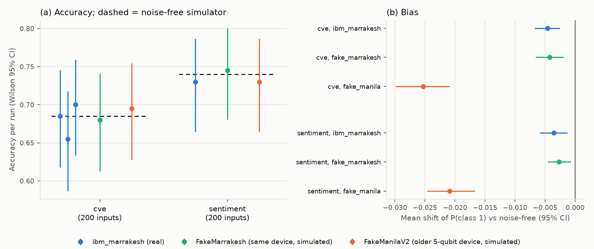

# Quantum text classifier (IBM Quantum ready)

[](https://doi.org/10.5281/zenodo.24148924)

Archived on Zenodo. The badge's concept DOI always resolves to the latest version.
To cite the exact code used in the paper, use v1.0.4:
[10.5281/zenodo.24150592](https://doi.org/10.5281/zenodo.24150592) (commit `16357c3`).

A small, honest quantum machine-learning project built with Qiskit. A 4-qubit
quantum neural network (QNN) classifies text. It runs on a local simulator, on a
simulated noisy IBM device, or on real IBM Quantum hardware:

- **Sentiment**: is a movie-review style opinion positive or negative?
- **CVE severity**: from a vulnerability description, is it HIGH/CRITICAL or LOW/MEDIUM?

Every quantum result is reported next to classical baselines on the same data,
because at this size quantum offers no advantage. The point is to learn how
quantum ML works and what hardware noise does to it, not to beat classical models.

The repo also scans its own dependencies for known CVEs (`security/`).

> Despite the repo's name, this is not an AGI. It is an experiment and a learning tool.

## How it works

```
text ──► sentence embedding (all-MiniLM-L6-v2, 384 numbers)
     ──► PLS: squeeze to 4 numbers that best predict the label, scaled to [0, π]
     ──► 4-qubit circuit: [RY(x) encoding → trainable RealAmplitudes layer] × 2
     ──► measure qubit 0 ──► P(class 1)
```

The classical encoder does most of the heavy lifting. The QNN makes the final
call on 4 numbers. The circuit's weights are trained on exact simulated
probabilities with L-BFGS-B on cross-entropy loss.

## Results

All numbers below are in `results/`. The paper ([H3XY/HonestQML-paper](https://github.com/H3XY/HonestQML-paper)) has the full methods.

**Text classifiers** (`python -m benchmark.uncertainty`): test accuracy, mean ± std over 3 seeds (the seed sets the 600-text training subset and the initial weights). Same-feature baselines are tuned by 5-fold cross-validation on the training subset.

| Model | Sentiment (1,066 test) | CVE severity (2,424 test) |
|---|---|---|
| Majority class | 0.500 | 0.578 |
| Quantum, 4 qubits | 0.757 ± 0.007 | 0.699 ± 0.015 |
| Logistic regression, same 4 features, CV-tuned | 0.772 ± 0.002 | 0.689 ± 0.004 |
| RBF SVM, same 4 features, CV-tuned | 0.770 ± 0.004 | 0.691 ± 0.008 |
| Logistic regression, full embedding, all data | 0.774 | 0.715 |
| Paired 95% CI, quantum minus tuned logistic regression | −0.030 to −0.002 | −0.009 to +0.023 |

These test sets were used while designing the circuit, so the numbers above are exploratory (on them, sentiment looked 1.5 points worse and CVE a tie). CVEs are split by publication date (training up to 9 April 2024, 50% high/critical; test after, 42%), so the model is tested on later CVEs.

**Pre-registered confirmatory test** (`python -m benchmark.confirmatory`; protocol [results/confirmatory/PROTOCOL.md](results/confirmatory/PROTOCOL.md), committed before the data was downloaded): frozen system, scored once on untouched data (Rotten Tomatoes validation split; 13,432 NVD CVEs published May-Aug 2024). Sentiment: QNN 0.766 vs tuned logistic regression 0.769, difference -0.003 [-0.017, +0.011], so the expected gap was **not** confirmed. CVE: 0.708 vs 0.720, difference -0.011 [-0.024, +0.003], a tie within the pre-set +/-3-point margin; the tuned SVM (0.726) is 1.8 points ahead of the QNN. The QNN is not ahead of any baseline. [results/confirmatory/confirmatory.md](results/confirmatory/confirmatory.md)

**Dequantization check** (`python -m benchmark.dequantize`; protocol [results/dequantization/PROTOCOL.md](results/dequantization/PROTOCOL.md), committed before running): because each feature is re-uploaded twice with R_Y, the QNN's output is exactly a trigonometric polynomial with frequencies {-2..2} per feature (verified: a least-squares fit in that basis reproduces the trained QNN to ~1e-15). A purely classical logistic regression on those 624 Fourier features, with the same inputs and training texts, scores 0.727 vs the QNN's 0.708 on the untouched CVE set (QNN classically matched; surrogate ahead, CI excludes 0), and 0.756 vs 0.766 on untouched sentiment (inconclusive, CI [-0.008, +0.029]), where plain logistic regression on the 4 features (0.769) beats both. [results/dequantization/dequantization.md](results/dequantization/dequantization.md)

**10-seed sensitivity analysis** (`python -m benchmark.confirmatory --extend`, then `python -m benchmark.dequantize --extend`; specified in [results/confirmatory/EXTENSION_10SEEDS.md](results/confirmatory/EXTENSION_10SEEDS.md) and committed before running). Three seeds give a coarse seed component in the intervals, so we added seeds 3-9 with everything else unchanged. This deviates from the protocol; the 3-seed verdicts above remain the primary ones. With 10 seeds the verdicts are unchanged and the intervals are narrower:
- Sentiment: QNN 0.766 vs tuned logistic regression 0.765, difference +0.001 [-0.011, +0.014]. Not confirmed.
- CVE: QNN 0.711 vs tuned logistic regression 0.720, difference -0.009 [-0.016, -0.002]. Tie within +/-3 points confirmed, though the QNN is now reliably, if slightly, behind. The tuned SVM (0.727) is 1.5 points ahead [-0.022, -0.009].
- Fourier surrogate: CVE 0.727 vs QNN 0.711, QNN minus surrogate -0.015 [-0.022, -0.010]. Classically matched.
- Fourier surrogate: sentiment 0.753 vs QNN 0.766, +0.013 [-0.000, +0.026]. Still inconclusive, with the surrogate nominally behind the QNN; plain logistic regression on the same 4 features (0.765) matches the QNN.

Reports: [results/confirmatory/confirmatory_10seeds.md](results/confirmatory/confirmatory_10seeds.md), [results/dequantization/dequantization_10seeds.md](results/dequantization/dequantization_10seeds.md)

**Which design choice mattered** (`python -m benchmark.ablation`, breast cancer, 3 seeds): in a 2x2 of encoding and re-uploading, `ZZFeatureMap` costs 24 points with re-uploading (0.910 to 0.667) and 19 without (0.887 to 0.700); re-uploading adds 2.3 points to angle encoding. Every other single choice (readout, optimizer, exact vs sampled training, 2 or 6 qubits) moves accuracy by at most 1.4 points. [results/ablation.md](results/ablation.md)

**Benchmark on smaller splits** (`python -m benchmark.run_benchmark`): one seed, 300 training and up to 200 test items, PCA for tabular data. The text-task numbers above supersede the text bars here.


**Real quantum hardware** (`python -m benchmark.hardware_study`, IBM `ibm_marrakesh`, 156-qubit Heron, 1,024 shots, no error mitigation). 200 test inputs per task, compiled once with a fixed transpiler seed so every run uses the same physical qubits, compared with noise-free simulation on the same inputs and with two local noise models:



- **Accuracy:** no run differs significantly from noise-free simulation on the same inputs (exact McNemar p = 1, 0.07, 0.45 for CVE; 0.63 for sentiment) (CVE 0.685, 0.655 and 0.700 over three runs vs 0.685 noise-free; sentiment 0.730 vs 0.740). Prediction changes are at the edge of the exact shot-noise expectation (19 vs 13.3 expected for CVE over three runs, p = 0.055; p = 0.37 for sentiment), and repeated runs agree on 96% of predictions.
- **Bias:** consistent in sign, varying in size. The device lowers mean P(class 1) in every run: per CVE run 0.0063 [0.0037, 0.0090] and 0.0053 [0.0025, 0.0081], then 0.0022 [-0.0002, 0.0046] three hours later under the same reported calibration (interval includes zero); pooled 0.0046 (two-level CI over runs and inputs [0.0016, 0.0076]). Sentiment: 0.0035 [0.0010, 0.0061].
- **Noise models:** `FakeMarrakesh` (a snapshot of the same device) reproduces that bias; `FakeManilaV2` (an older 5-qubit device) overstates it about fivefold and changes significantly more predictions than shot noise allows.
- **Other devices** (`python -m benchmark.cross_device`): one CVE run each on `ibm_kingston` and `ibm_fez`, on 100 of the same inputs. Accuracy again shows no significant change, and the output shift has the same sign on every device but a different size: Marrakesh -0.005, Kingston -0.009, Fez -0.015 (Fez significantly larger than both). `FakeFez` understates Fez's shift (-0.009), so a same-device noise model matched Marrakesh but not Fez. [results/hardware_study/cross_device.md](results/hardware_study/cross_device.md)

Details, job IDs and the calibration snapshot: [results/hardware_study/report.md](results/hardware_study/report.md), [results/ibm_jobs.json](results/ibm_jobs.json). An earlier 40-input run per dataset ([results/benchmark.md](results/benchmark.md), [results/hardware_repeats_cve.md](results/hardware_repeats_cve.md), exact statistics in [results/uncertainty.md](results/uncertainty.md)) is superseded by this study.

## Setup

Requires Python 3.11+ (developed on 3.12).

```bash
python3.12 -m venv .venv
source .venv/bin/activate
pip install -r requirements.txt
```

The first run downloads the datasets into `data/` (gitignored) and the embedding
model (~91 MB) into the Hugging Face cache:
- Rotten Tomatoes sentences (~0.8 MB, Hugging Face)
- NVD CVEs published Jan–Apr 2024 (~53 MB over the NVD API, stored as ~2 MB)

Trained models are committed in `models/`, so the chat works without retraining.

## Usage

All commands run from the repo root.

```bash
# Chat with a classifier
./run_local.sh                       # sentiment
./run_local.sh --task cve            # CVE severity; paste a vulnerability description

# Retrain (about 4 to 5 minutes each)
python train.py --task sentiment
python train.py --task cve
python train.py --task cve --qubits 6 --train-samples 1000   # bigger and slower

# Quantum vs classical benchmark with a simulated noisy IBM device
python -m benchmark.run_benchmark                    # all datasets, about 10 minutes
python -m benchmark.run_benchmark --datasets iris moons

# Run on IBM Quantum (see ibmq/README_IBMQ.md for credentials)
python -m ibmq.run_on_ibmq --fake                    # simulated IBM noise, no account needed
python -m ibmq.run_on_ibmq --task cve "Heap overflow in the TLS parser allows remote code execution"
python -m benchmark.run_benchmark --hardware          # adds a real-hardware comparison
python -m benchmark.hardware_study --fake-only        # hardware study on local noise models (free)
python -m benchmark.hardware_study --runs 3            # real device; checks the remaining IBM allowance first
python -m benchmark.hardware_study_report && python -m benchmark.hardware_study_figure
python -m benchmark.uncertainty                        # seeds, tuned baselines, CIs (~40 min, CPU)
python -m benchmark.ablation                           # circuit-design ablation (~20 min, CPU)
python -m benchmark.cross_device                       # compare ibm_marrakesh, ibm_kingston, ibm_fez on 100 shared inputs (seconds)
python -m benchmark.dequantize                         # classical Fourier surrogates of the QNN (~5 min, CPU)
python -m benchmark.confirmatory                       # pre-registered test on untouched data (~45 min, CPU)
python -m benchmark.confirmatory --extend              # 10-seed sensitivity analysis (~2 h, CPU); then benchmark.dequantize --extend

# Scan dependencies for known CVEs (pip-audit)
./security/audit_deps.sh
```

## Repo layout

```
run.py, run_local.sh      chat app (perceive → reason → act → reflect)
train.py                  train a text classifier → models/<task>.joblib
core/
  qnn_core.py             circuit, QNN, training
  features.py             standardise → PCA/PLS → angles in [0, π]
  text_encoder.py         sentence embeddings
  text_tasks.py           sentiment + CVE tasks, datasets, cached embeddings
  cve_data.py             NVD API download and parsing
  text_classifier.py      load a trained model and score text
  agent.py, memory.py     chat agent and session memory
benchmark/                quantum vs classical benchmark, hardware repeat study → results/
ibmq/                     IBM Quantum Runtime scripts and credentials guide
security/                 dependency CVE scan (pip-audit)
.github/workflows/        weekly and on-change dependency audit in CI
models/                   trained models (committed)
results/                  benchmark chart and tables, training metrics, audit report
data/                     downloaded datasets and embeddings (gitignored)
```

## Limitations

- 4 qubits means 4 numbers per text. The classical encoder and PLS decide most of what the model can know.
- Training uses Qiskit 1.x's exact reference `Sampler`, which is removed in Qiskit 2, so Qiskit is pinned below 2.
- CVE severity from the description alone is an approximation. Real CVSS scoring also uses attack vector, privileges and so on, which are often only implied by the text.
- Real-hardware runs use your IBM account's quantum time and wait in IBM's queue.

## License

MIT
